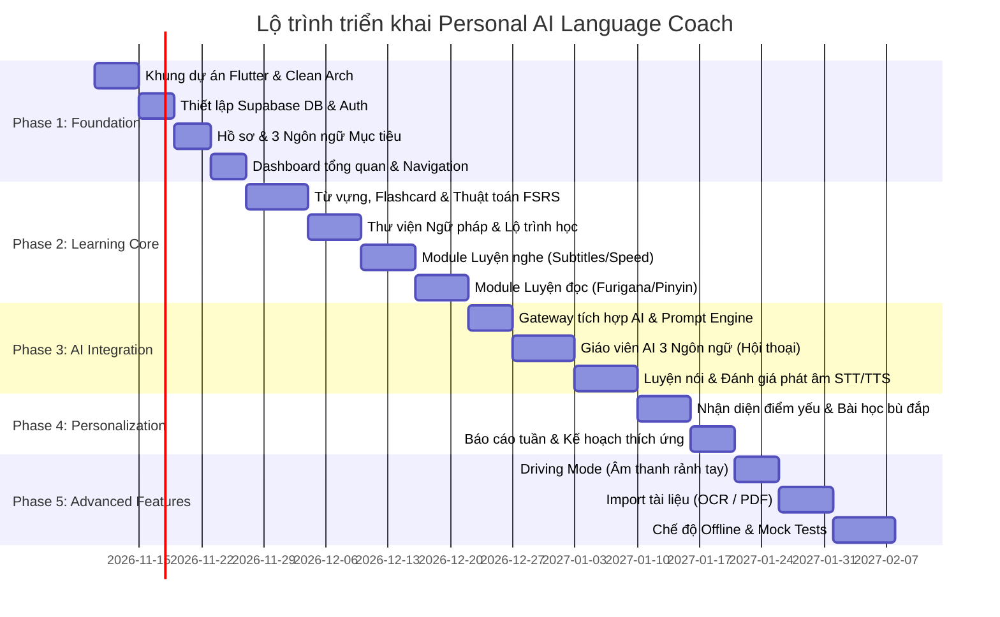

# HỆ THỐNG KIẾN TRÚC & THIẾT KẾ KỸ THUẬT (TECHNICAL ARCHITECTURE & SPECIFICATION)
## DỰ ÁN: PERSONAL AI LANGUAGE COACH (EN - JA - ZH)

**Phiên bản tài liệu:** 1.0  
**Ngày lập:** Tháng 11/2026  
**Công nghệ chủ đạo:** Flutter (Dart) • Riverpod • Supabase (PostgreSQL / Auth / Storage) • Gemini / OpenAI API • Whisper STT • Cloud TTS  

---

## 1. TỔNG QUAN KIẾN TRÚC HỆ THỐNG (SYSTEM ARCHITECTURE)

Ứng dụng tuân theo mô hình **Clean Architecture** kết hợp với **Feature-First Pattern**, phân tách ranh giới rõ ràng giữa Giao diện (Presentation), Nghiệp vụ (Domain), Dữ liệu (Data) và Tích hợp AI/Audio (AI Services).

```mermaid
graph TD
    subgraph Presentation Layer ["1. Presentation Layer (Flutter + Riverpod)"]
        UI_Dash["Dashboard / Home"]
        UI_Learn["Learning Path (TOEIC/N3/HSK3)"]
        UI_AI["AI Teacher & Chat (Voice/Text)"]
        UI_Skills["4 Skills (Listen, Speak, Read, Write)"]
        UI_Vocab["Vocab & Flashcard (FSRS)"]
        UI_Drive["Driving Mode (Audio Only)"]
    end

    subgraph Domain Layer ["2. Domain Layer (Pure Dart)"]
        UC_Learn["Learning & Evaluation UseCases"]
        UC_FSRS["Spaced Repetition Engine (FSRS)"]
        UC_AI["AI Coach & Prompt Pipeline"]
        UC_LangEngine["Linguistic Engine (IPA/Furigana/Pinyin)"]
    end

    subgraph Data Layer ["3. Data Layer (Repositories & DataSources)"]
        Repo_Impl["Repository Implementations"]
        Local_DB["Local SQLite / Drift (Offline Cache)"]
        Remote_Supa["Supabase Client (PostgreSQL + Auth + Storage)"]
    end

    subgraph AI and Media Layer ["4. AI & Media Integration Subsystem"]
        AI_Gateway["AI Provider Gateway (Gemini / OpenAI API)"]
        STT_Engine["Speech-to-Text (Whisper / On-Device STT)"]
        TTS_Engine["Text-to-Speech (Google Cloud TTS / Edge TTS)"]
        Audio_Recorder["Audio Recorder & Player (flutter_sound / just_audio)"]
    end

    Presentation Layer --> Domain Layer
    Domain Layer --> Data Layer
    Data Layer --> Remote_Supa
    Data Layer --> Local_DB
    Domain Layer --> AI and Media Layer
```

---

## 2. CƠ SỞ DỮ LIỆU CHUẨN HÓA (SUPABASE / POSTGRESQL DDL)

Cơ sở dữ liệu bao gồm 23 bảng theo đúng yêu cầu Section 21 của URS, kích hoạt RLS (Row Level Security) bảo vệ dữ liệu người dùng.

### 2.1. Bảng Ngôn ngữ và Người dùng
```sql
-- 1. Users Profile
CREATE TABLE users (
    id UUID PRIMARY KEY REFERENCES auth.users(id) ON DELETE CASCADE,
    email TEXT UNIQUE NOT NULL,
    display_name TEXT NOT NULL,
    native_language VARCHAR(5) DEFAULT 'vi',
    daily_study_target_minutes INT DEFAULT 30,
    preferred_study_time VARCHAR(20) DEFAULT 'evening', -- morning, afternoon, evening
    created_at TIMESTAMPTZ DEFAULT NOW(),
    updated_at TIMESTAMPTZ DEFAULT NOW()
);

-- 2. User Languages (3 ngôn ngữ: en, ja, zh)
CREATE TABLE user_languages (
    id UUID PRIMARY KEY DEFAULT gen_random_uuid(),
    user_id UUID REFERENCES users(id) ON DELETE CASCADE,
    language_code VARCHAR(5) NOT NULL, -- 'en', 'ja', 'zh'
    current_level VARCHAR(20) NOT NULL, -- 'Beginner', 'Elementary', 'Intermediate'
    is_active BOOLEAN DEFAULT TRUE,
    created_at TIMESTAMPTZ DEFAULT NOW(),
    UNIQUE(user_id, language_code)
);

-- 3. Learning Goals
CREATE TABLE learning_goals (
    id UUID PRIMARY KEY DEFAULT gen_random_uuid(),
    user_id UUID REFERENCES users(id) ON DELETE CASCADE,
    language_code VARCHAR(5) NOT NULL,
    target_benchmark VARCHAR(50) NOT NULL, -- 'TOEIC 600', 'JLPT N3', 'HSK 3'
    target_date DATE,
    priority_level INT DEFAULT 1,
    current_progress_percent NUMERIC(5,2) DEFAULT 0.00,
    created_at TIMESTAMPTZ DEFAULT NOW(),
    updated_at TIMESTAMPTZ DEFAULT NOW(),
    UNIQUE(user_id, language_code)
);
```

### 2.2. Lộ trình học (Learning Paths, Modules & Lessons)
```sql
-- 4. Learning Paths
CREATE TABLE learning_paths (
    id UUID PRIMARY KEY DEFAULT gen_random_uuid(),
    language_code VARCHAR(5) NOT NULL,
    title TEXT NOT NULL,
    benchmark_code VARCHAR(20) NOT NULL, -- 'TOEIC_600', 'JLPT_N3', 'HSK_3'
    description TEXT,
    total_phases INT DEFAULT 5,
    created_at TIMESTAMPTZ DEFAULT NOW()
);

-- 5. Learning Modules
CREATE TABLE learning_modules (
    id UUID PRIMARY KEY DEFAULT gen_random_uuid(),
    path_id UUID REFERENCES learning_paths(id) ON DELETE CASCADE,
    phase_order INT NOT NULL,
    title TEXT NOT NULL,
    description TEXT,
    skill_focus VARCHAR(20) NOT NULL -- 'all', 'listening', 'speaking', 'reading', 'writing', 'grammar'
);

-- 6. Lessons
CREATE TABLE lessons (
    id UUID PRIMARY KEY DEFAULT gen_random_uuid(),
    module_id UUID REFERENCES learning_modules(id) ON DELETE CASCADE,
    lesson_order INT NOT NULL,
    title TEXT NOT NULL,
    estimated_minutes INT DEFAULT 15,
    content_json JSONB NOT NULL,
    is_published BOOLEAN DEFAULT TRUE
);
```

### 2.3. Từ vựng và Ngữ pháp (Vocabulary, Grammar & FSRS)
```sql
-- 7. Vocabulary Master Dictionary
CREATE TABLE vocabulary (
    id UUID PRIMARY KEY DEFAULT gen_random_uuid(),
    language_code VARCHAR(5) NOT NULL,
    word TEXT NOT NULL,
    meaning_vi TEXT NOT NULL,
    part_of_speech VARCHAR(30),
    level VARCHAR(10) NOT NULL, -- 'A1', 'A2', 'B1', 'N5', 'N4', 'N3', 'HSK1', 'HSK2', 'HSK3'
    phonetic_ipa TEXT, -- Cho tiếng Anh
    kanji TEXT, -- Cho tiếng Nhật
    furigana TEXT, -- Cho tiếng Nhật
    romaji TEXT, -- Cho tiếng Nhật
    simplified_chinese TEXT, -- Cho tiếng Trung
    pinyin TEXT, -- Cho tiếng Trung
    tone_marks INT, -- 1, 2, 3, 4, 5
    example_sentence TEXT,
    example_translation TEXT,
    audio_url TEXT,
    topic VARCHAR(50),
    created_at TIMESTAMPTZ DEFAULT NOW(),
    UNIQUE(language_code, word)
);

-- 8. User Vocabulary (Sở hữu cá nhân & trạng thái FSRS)
CREATE TABLE user_vocabulary (
    id UUID PRIMARY KEY DEFAULT gen_random_uuid(),
    user_id UUID REFERENCES users(id) ON DELETE CASCADE,
    vocab_id UUID REFERENCES vocabulary(id) ON DELETE CASCADE,
    status VARCHAR(20) DEFAULT 'new', -- 'new', 'learning', 'review', 'known'
    -- FSRS Scheduling Fields
    stability NUMERIC(10,4) DEFAULT 0.0,
    difficulty NUMERIC(10,4) DEFAULT 0.0,
    reps INT DEFAULT 0,
    lapses INT DEFAULT 0,
    state INT DEFAULT 0, -- 0=New, 1=Learning, 2=Review, 3=Relearning
    last_review TIMESTAMPTZ,
    next_review TIMESTAMPTZ DEFAULT NOW(),
    created_at TIMESTAMPTZ DEFAULT NOW(),
    UNIQUE(user_id, vocab_id)
);

-- 9. Grammar Master Table
CREATE TABLE grammar (
    id UUID PRIMARY KEY DEFAULT gen_random_uuid(),
    language_code VARCHAR(5) NOT NULL,
    level VARCHAR(10) NOT NULL,
    rule_name TEXT NOT NULL,
    explanation_vi TEXT NOT NULL,
    structure_formula TEXT NOT NULL,
    example_sentence TEXT NOT NULL,
    example_translation TEXT NOT NULL,
    common_mistakes_vi TEXT,
    created_at TIMESTAMPTZ DEFAULT NOW()
);
```

### 2.4. Bài tập và Đánh giá (Exercises & Results)
```sql
-- 10. Exercises
CREATE TABLE exercises (
    id UUID PRIMARY KEY DEFAULT gen_random_uuid(),
    lesson_id UUID REFERENCES lessons(id) ON DELETE CASCADE,
    exercise_type VARCHAR(30) NOT NULL, -- 'multiple_choice', 'dictation', 'shadowing', 'fill_blank'
    skill VARCHAR(20) NOT NULL, -- 'listening', 'speaking', 'reading', 'writing'
    prompt_question TEXT NOT NULL,
    media_url TEXT,
    options_json JSONB,
    correct_answer TEXT NOT NULL,
    explanation_vi TEXT
);

-- 11. Exercise Results
CREATE TABLE exercise_results (
    id UUID PRIMARY KEY DEFAULT gen_random_uuid(),
    user_id UUID REFERENCES users(id) ON DELETE CASCADE,
    exercise_id UUID REFERENCES exercises(id) ON DELETE CASCADE,
    user_answer TEXT,
    is_correct BOOLEAN NOT NULL,
    accuracy_score NUMERIC(5,2),
    created_at TIMESTAMPTZ DEFAULT NOW()
);
```

### 2.5. AI Teacher & Hội thoại 2 chiều
```sql
-- 12. Conversations
CREATE TABLE conversations (
    id UUID PRIMARY KEY DEFAULT gen_random_uuid(),
    user_id UUID REFERENCES users(id) ON DELETE CASCADE,
    language_code VARCHAR(5) NOT NULL,
    scenario_title TEXT NOT NULL, -- e.g. "Business Meeting", "Ask Directions"
    created_at TIMESTAMPTZ DEFAULT NOW()
);

-- 13. Conversation Messages
CREATE TABLE conversation_messages (
    id UUID PRIMARY KEY DEFAULT gen_random_uuid(),
    conversation_id UUID REFERENCES conversations(id) ON DELETE CASCADE,
    sender_role VARCHAR(10) NOT NULL, -- 'user', 'ai'
    message_text TEXT NOT NULL,
    audio_url TEXT,
    -- Phân tích lỗi thông minh từ AI (UR-AI-004)
    error_category VARCHAR(30), -- 'grammar', 'vocabulary', 'pronunciation', 'word_order', 'expression'
    correction_text TEXT,
    explanation_vi TEXT,
    natural_alternative TEXT,
    created_at TIMESTAMPTZ DEFAULT NOW()
);
```

### 2.6. Thư viện Kỹ năng & Luyện tập (Listening, Reading, Writing, Speaking)
```sql
-- 14. Listening Materials
CREATE TABLE listening_materials (
    id UUID PRIMARY KEY DEFAULT gen_random_uuid(),
    language_code VARCHAR(5) NOT NULL,
    level VARCHAR(10) NOT NULL,
    title TEXT NOT NULL,
    topic VARCHAR(50),
    audio_url TEXT NOT NULL,
    duration_seconds INT NOT NULL,
    transcript_json JSONB NOT NULL, -- mảng [{timestamp: "00:05", text: "...", pinyin/furigana: "...", vi: "..."}]
    created_at TIMESTAMPTZ DEFAULT NOW()
);

-- 15. Reading Materials
CREATE TABLE reading_materials (
    id UUID PRIMARY KEY DEFAULT gen_random_uuid(),
    language_code VARCHAR(5) NOT NULL,
    level VARCHAR(10) NOT NULL,
    title TEXT NOT NULL,
    content_raw TEXT NOT NULL,
    content_annotated_json JSONB NOT NULL, -- hỗ trợ nhấn từ tra nghĩa & Furigana/Pinyin
    translation_vi TEXT NOT NULL,
    questions_json JSONB NOT NULL
);

-- 16. Writing Submissions
CREATE TABLE writing_submissions (
    id UUID PRIMARY KEY DEFAULT gen_random_uuid(),
    user_id UUID REFERENCES users(id) ON DELETE CASCADE,
    language_code VARCHAR(5) NOT NULL,
    topic_prompt TEXT NOT NULL,
    original_text TEXT NOT NULL,
    corrected_text TEXT,
    ai_feedback_vi TEXT,
    score NUMERIC(5,2),
    created_at TIMESTAMPTZ DEFAULT NOW()
);

-- 17. Speaking Records
CREATE TABLE speaking_records (
    id UUID PRIMARY KEY DEFAULT gen_random_uuid(),
    user_id UUID REFERENCES users(id) ON DELETE CASCADE,
    language_code VARCHAR(5) NOT NULL,
    scenario_or_prompt TEXT NOT NULL,
    user_audio_url TEXT,
    transcribed_text TEXT,
    fluency_score NUMERIC(5,2),
    grammar_score NUMERIC(5,2),
    vocabulary_score NUMERIC(5,2),
    pronunciation_score NUMERIC(5,2),
    comprehension_score NUMERIC(5,2),
    response_score NUMERIC(5,2),
    feedback_vi TEXT,
    created_at TIMESTAMPTZ DEFAULT NOW()
);
```

### 2.7. Ôn tập, Tiến độ & Cá nhân hóa (Review, Progress, Driving Mode, Custom Materials)
```sql
-- 18. Review Schedule
CREATE TABLE review_schedule (
    id UUID PRIMARY KEY DEFAULT gen_random_uuid(),
    user_id UUID REFERENCES users(id) ON DELETE CASCADE,
    language_code VARCHAR(5) NOT NULL,
    item_type VARCHAR(20) NOT NULL, -- 'vocabulary', 'grammar', 'mistake_pattern'
    item_id UUID NOT NULL,
    scheduled_for DATE NOT NULL,
    is_completed BOOLEAN DEFAULT FALSE
);

-- 19. Learning Progress
CREATE TABLE learning_progress (
    id UUID PRIMARY KEY DEFAULT gen_random_uuid(),
    user_id UUID REFERENCES users(id) ON DELETE CASCADE,
    language_code VARCHAR(5) NOT NULL,
    date DATE NOT NULL,
    study_duration_seconds INT DEFAULT 0,
    words_learned INT DEFAULT 0,
    words_reviewed INT DEFAULT 0,
    listening_minutes INT DEFAULT 0,
    speaking_minutes INT DEFAULT 0,
    estimated_benchmark_score INT,
    UNIQUE(user_id, language_code, date)
);

-- 20. Error Patterns (Nhận diện điểm yếu tích lũy từ AI)
CREATE TABLE error_patterns (
    id UUID PRIMARY KEY DEFAULT gen_random_uuid(),
    user_id UUID REFERENCES users(id) ON DELETE CASCADE,
    language_code VARCHAR(5) NOT NULL,
    category VARCHAR(30) NOT NULL, -- 'grammar', 'tone', 'particle_ha_ga', 'past_tense'
    pattern_description TEXT NOT NULL,
    frequency_count INT DEFAULT 1,
    remedy_lesson_id UUID REFERENCES lessons(id),
    last_occurred TIMESTAMPTZ DEFAULT NOW()
);

-- 21. Daily Learning Plan
CREATE TABLE daily_learning_plan (
    id UUID PRIMARY KEY DEFAULT gen_random_uuid(),
    user_id UUID REFERENCES users(id) ON DELETE CASCADE,
    plan_date DATE NOT NULL,
    plan_json JSONB NOT NULL, -- danh sách bài học, số từ cần ôn, thời gian đề xuất
    is_completed BOOLEAN DEFAULT FALSE
);

-- 22. User Materials (Tài liệu người dùng tải lên: PDF/Ảnh OCR/Text)
CREATE TABLE user_materials (
    id UUID PRIMARY KEY DEFAULT gen_random_uuid(),
    user_id UUID REFERENCES users(id) ON DELETE CASCADE,
    language_code VARCHAR(5) NOT NULL,
    file_type VARCHAR(10) NOT NULL, -- 'pdf', 'image', 'text'
    source_url TEXT,
    extracted_text TEXT NOT NULL,
    ai_generated_lesson_json JSONB,
    created_at TIMESTAMPTZ DEFAULT NOW()
);

-- 23. Study Sessions
CREATE TABLE study_sessions (
    id UUID PRIMARY KEY DEFAULT gen_random_uuid(),
    user_id UUID REFERENCES users(id) ON DELETE CASCADE,
    language_code VARCHAR(5) NOT NULL,
    session_mode VARCHAR(20) NOT NULL, -- 'normal', 'driving_mode', 'quick_review'
    duration_seconds INT NOT NULL,
    started_at TIMESTAMPTZ NOT NULL,
    ended_at TIMESTAMPTZ NOT NULL
);
```

---

## 3. QUẢN LÝ AI PROMPT & CẤU TRÚC JSON PHẢN HỒI (AI PROMPT SYSTEM)

Tất cả các prompt được định nghĩa độc lập dưới dạng template, nhận tham số và trả về JSON chuẩn hóa để UI Flutter phân tích tự động.

### Danh mục Prompt chuẩn (AI-001 đến AI-012):

| Prompt ID | Vai trò / Nghiệp vụ | Input Model | Expected Structured Output Format |
|---|---|---|---|
| **AI-001** | English Teacher Chat | User voice transcript, scenario | `{ reply_en, reply_vi_hint, feedback: { errors: [...] }, next_question }` |
| **AI-002** | Japanese Teacher Chat | User speech/text, context, JLPT | `{ reply_ja, furigana_map, explanation_vi, corrections: [...] }` |
| **AI-003** | Chinese Teacher Chat | User input, HSK level | `{ reply_zh, pinyin, tones_highlight, explanation_vi, corrections: [...] }` |
| **AI-004** | Grammar Explanation | Sentence / query | `{ formula, meaning_vi, examples: [...], common_mistakes: [...] }` |
| **AI-005** | Vocabulary Breakdown | Word, language, context | `{ word, phonetic, kanji/pinyin, meaning_vi, collocations: [...], examples: [...] }` |
| **AI-006** | Speaking Evaluation | Transcribed text, audio metadata, prompt | `{ fluency_score, pronunciation_score, grammar_score, error_breakdown: [...], encouragement_vi }` |
| **AI-007** | Writing Correction | Submitted essay/paragraph, prompt | `{ overall_score, corrected_text, diff_highlights: [...], grammar_notes_vi, natural_expression_tips }` |
| **AI-008** | Listening Question Gen | Audio transcript, target level | `{ questions: [{ question, options, correct_idx, explanation_vi }] }` |
| **AI-009** | Reading Comprehension | Raw text / article | `{ annotated_tokens: [...], translation_vi, vocab_list: [...], quiz: [...] }` |
| **AI-010** | Daily Plan Generation | User progress, weak points, daily time | `{ tasks: [{ skill, duration, title, target_id }] }` |
| **AI-011** | Error Pattern Analysis | Recent mistake history | `{ dominant_weakness, explanation_vi, remedial_drill: [...] }` |
| **AI-012** | Weekly Learning Report | 7-day metrics, scores, sessions | `{ summary_vi, strengths: [...], weaknesses: [...], next_week_focus: [...] }` |

---

## 4. CẤU TRÚC THƯ MỤC DỰ ÁN FLUTTER (FEATURE-FIRST CLEAN ARCHITECTURE)

```
lib/
├── main.dart
├── app.dart
├── core/
│   ├── config/              # App config, environment variables, Supabase constants
│   ├── constants/           # Colors, typography, spacing, assets
│   ├── network/             # Supabase client, HTTP client with retry logic
│   ├── database/            # Local SQLite (Drift) & local secure storage
│   ├── errors/              # Custom failure classes, error handlers
│   ├── audio/               # JustAudio & FlutterSound wrappers, background playback
│   ├── ai/                  # AI Gateway (Gemini/OpenAI), prompt registry (AI-001 -> 012)
│   ├── linguistic/          # Pinyin generator, Furigana parser, IPA helper
│   └── fsrs/                # Free Spaced Repetition Scheduler algorithm
├── features/
│   ├── auth/                # Sign in, Sign up, Forgot password
│   ├── user_profile/        # Profile setup, target benchmark (TOEIC/N3/HSK3), daily target
│   ├── dashboard/           # Home dashboard with 3 language cards, progress, quick launch
│   ├── learning_path/       # Roadmaps for English, Japanese, Chinese (Phases, Modules, Lessons)
│   ├── ai_teacher/          # Conversational AI Coach with 2-way audio/text & smart corrections
│   ├── listening/           # Player with speed control (0.5x-1.5x), subtitles, dictation, shadowing
│   ├── speaking/            # STT, situation roleplay, pronunciation radar score
│   ├── reading/             # Reading viewer with Furigana/Pinyin toggles, 1-tap word lookup
│   ├── writing/             # Writing practice, email/journal simulator, AI auto-correction
│   ├── vocabulary/          # Dictionary, Flashcards (5 modes), FSRS review sessions
│   ├── grammar/             # Grammar rulebook, structured formulas, error remedies
│   ├── progress/            # Analytics, skill radars, estimated benchmark score
│   ├── driving_mode/        # Audio-first distraction-free mode (1-tap pause, voice Q&A)
│   └── materials/           # Document importer (Text, PDF, Image OCR)
└── widgets/                 # Reusable shared UI widgets (buttons, cards, audio wave, dialogs)
```

---

## 5. KẾ HOẠCH TRIỂN KHAI THEO 5 GIAI ĐOẠN (IMPLEMENTATION ROADMAP)



---

## 6. SẴN SÀNG KHỞI TẠO DỰ ÁN

Tài liệu này là căn cứ kỹ thuật chính xác nhất để bước vào **Giai đoạn 1 (Phase 1 – Foundation)**:
1. Tạo cấu trúc thư mục Flutter chuẩn Clean Architecture.
2. Thiết lập cấu hình kết nối Supabase, các model thực thể (Entity Models).
3. Triển khai logic quản lý 3 ngôn ngữ và Dashboard tổng quan.
